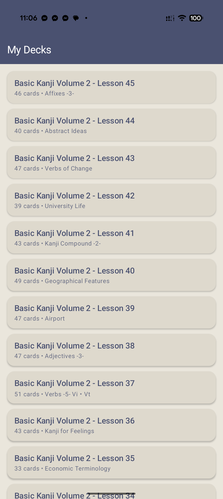
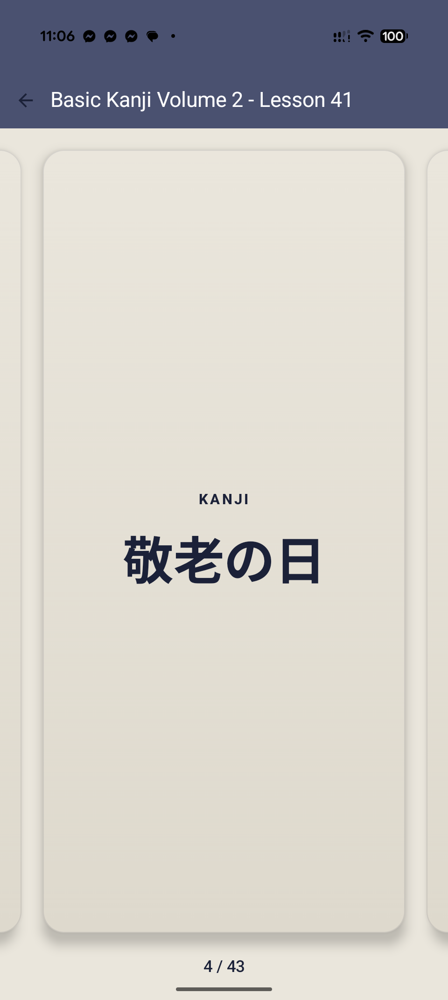
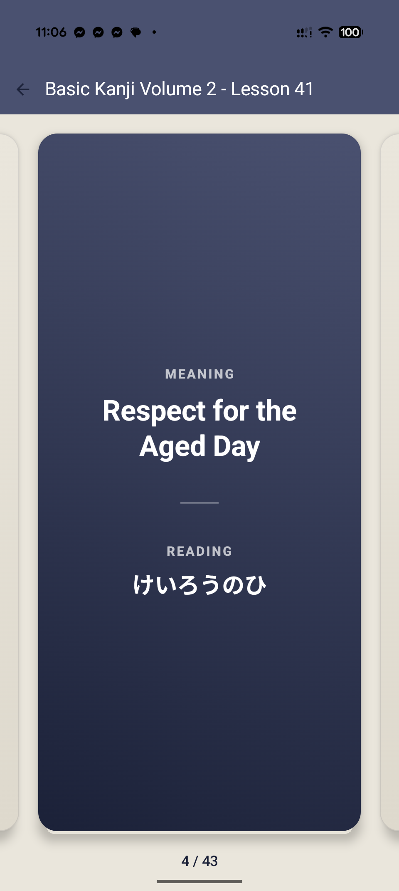
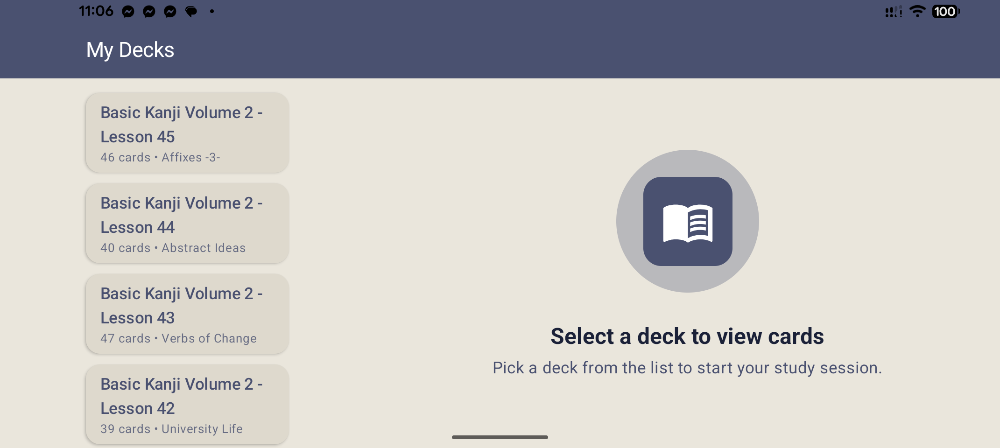
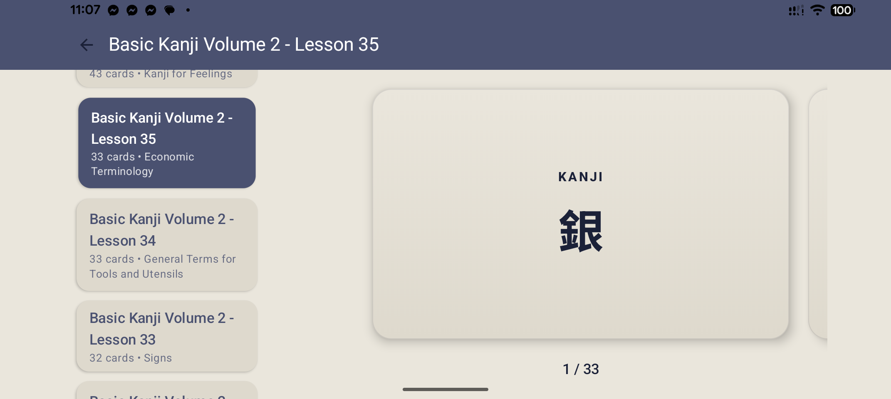
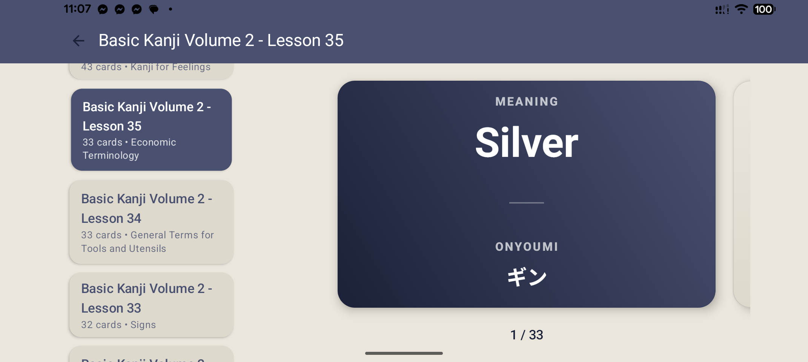

# Flashcards - Custom Study Cards

I built this Android flashcard app to help me study kanji and Japanese vocabulary. It stores decks and cards on the device and supports both portrait and landscape study layouts.

## Showcase

  
  
  
  

## Core Features
- Study cards with a flip animation to reveal meanings and readings.
- Keep decks and cards available offline with local storage.
- Use a list-detail layout that adapts to phones, tablets, and foldables.
- Study in portrait or landscape, with layouts that account for display cutouts and system bars.

## Technical Stack
- **Jetpack Compose**: Declarative UI with Material 3 components.
- **Material 3 Adaptive**: List-detail layouts.
- **State & Navigation**: MVVM with StateFlow and Navigation 3.
- **Room**: Local storage for decks and cards.
- **Hilt**: Dependency injection.
- **Build**: Kotlin 2.4 and Android Gradle Plugin 9.3.

## Screenshots

### Portrait Mode

  
  
  

### Landscape Mode

  

  

  

